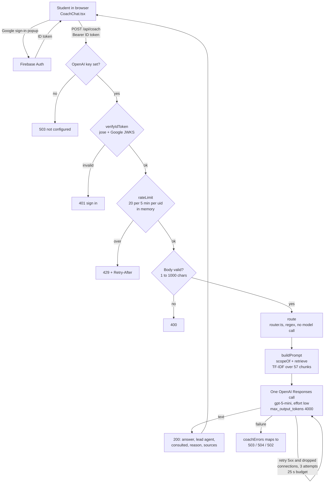
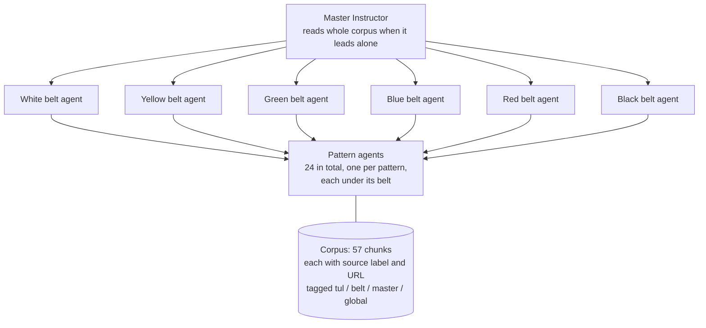
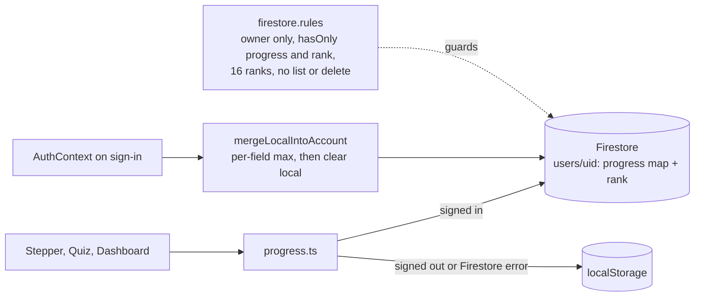

# Architecture

Blue Cottage Mini is a Next.js app (Next 16.3.8, React 19.2.8) that tours the 24 ITF patterns. A Master Instructor, 6 belt agents and 24 pattern agents answer questions from a small cited corpus. This page describes the code as it is on `main` at commit `c8d68e4`. Anything not built is listed under [Not built](#not-built).

Services in use: OpenAI (generation), Firebase Auth and Firestore (sign-in, progress), Netlify (hosting), GitHub Actions (CI). **No AWS service is used anywhere in the code.**

## The coach request path

Source: [`src/app/api/coach/route.ts`](../src/app/api/coach/route.ts).

## The agents

Agents are data, not processes ([`registry.ts`](../src/lib/agents/registry.ts)). Each agent is an id, a parent, a corpus tag and a persona string. All personas share one rule block: answer only from the excerpts, never invent movements, say so when movement text isn't on file.

There are 31 agents: 1 Master, 6 belts (white, yellow, green, blue, red, black), 24 patterns. `registry.test.ts` covers the roster.

### Routing

[`router.ts`](../src/lib/agents/router.ts) is deterministic regex matching with no model call. In order:

1. Two or more patterns named: the Master leads and consults up to 3 (`MAX_CONSULTED`).
2. One pattern named: its agent leads, and one named belt or rank is consulted.
3. A belt or rank named: that belt's agent leads.
4. A page focus (the pattern page the student asked from): that pattern's agent leads.
5. An agent the student chose: it leads, unless it's the Master.
6. Otherwise the Master leads.

Names match with hyphen, space or no separator ("Do-San", "do san", "dosan") plus a small alias table for common spellings. The route carries a plain-language `reason` that the UI shows the student. The `/agents` page previews routing live, which costs nothing because no model is called.

### One model call

[`prompt.ts`](../src/lib/agents/prompt.ts) builds the prompt. `scopeOf` takes the union of the lead's and consulted agents' corpus tags, plus `global`. A Master-led question with nobody consulted sees the whole corpus. `retrieve` scores chunks with TF-IDF over tokens, normalised by chunk length, with a boost when the query names a chunk's label. If scored retrieval finds nothing for a scoped agent, `baseline` hands it its first four chunks. The route then makes one model call. A swarm answer costs the same as a single-agent answer.

## Sources and provenance

Every `Chunk` in [`corpus.ts`](../src/lib/corpus.ts) has a `source` of `{label, url}`. The route returns the deduped source list with each answer, and `CoachChat.tsx` renders it under the answer. [`src/data/sources.json`](../src/data/sources.json) is the register shown on `/sources`, with licence per source.

The 57 chunks are 24 pattern fact chunks, 23 namesake chunks, 6 belt overviews and 4 global or master chunks (roster, history, practice principles, program description). Movement chunks would add one per movement, but `src/data/movements.json` is `{}`, so there are none.

`tools/build_open_data.mjs` rebuilds `teul.json` from Wikipedia (with revision ids) and checks each video through YouTube's oEmbed endpoint.

## Sign-in and access

- Client: Firebase Google sign-in popup ([`AuthContext.tsx`](../src/context/AuthContext.tsx)). Firebase turns on only when the API key, project id and app id are all set. Without them the app runs with sign-in hidden and the coach returns 503.
- Server: [`verifyIdToken.ts`](../src/lib/verifyIdToken.ts) checks the RS256 signature against Google's public keys with `jose`, plus issuer, audience and expiry. It uses no service-account key. Any failure returns `null`, and the route answers 401.
- Only `/api/coach` requires sign-in. It's the one part that costs money per call.

## Progress

Progress is per pattern: `practiced`, `quizBest`, `updatedAt`. Rank is self-declared, one of 16 strings shared between `rank.ts` and `firestore.rules`; a test fails if they drift. The dashboard tracks patterns only.

## Failure handling

| Failure | Where | Behavior |
| --- | --- | --- |
| No OpenAI key | `route.ts` | 503, "not configured" |
| Bad or missing token | `verifyIdToken.ts` | 401, reason never sent to the client |
| Over 20 questions in 5 min | `rateLimit.ts` | 429 with `Retry-After`. State is in process memory, so it resets on cold start and isn't shared across instances |
| Upstream 5xx, dropped connection | `retry.ts` | Up to 3 attempts, backoff 500 ms then 1500 ms, all inside a 25 s deadline |
| Out of credit (429 `insufficient_quota`) | `coachErrors.ts` | 503, tells the student to contact their instructor. Checked before the generic 429 case |
| Bad key, missing model, 400, 401, 403, 404 | `coachErrors.ts` | 503 "needs attention", not "try again" |
| Timeout | `coachErrors.ts` | 504 |
| Empty model text | `route.ts` | Logs status, incomplete reason and usage, returns 502, no retry |
| Firestore read or write fails | `progress.ts` | Logs, falls back to localStorage |
| Sign-in merge fails | `progress.ts` | Keeps the local copy for the next sign-in |

`retry.test.ts` (9 tests) and `coachErrors.test.ts` (20 tests) cover the retry and error policy without spending API credit.

## Delivery

GitHub Actions runs `npm ci`, typecheck, lint, test and build on every push to `main` and every pull request, plus `npm audit --audit-level=critical`. Netlify builds and hosts the app. `netlify.toml` lists the non-secret values the secrets scanner should skip. The Firestore rules test (`npm run test:rules`) needs Java and the emulator and doesn't run in CI.

## Not built

These are absent from the code. Where a decision record covers one, it's linked.

- **Human sign-off at run time.** No approval step exists for answers, content or ranks. The only human gate is the data file for movement text, which the instructor fills in by hand. See [ADR 0003](decisions/0003-human-sign-off-and-audit.md).
- **Audit records.** The only logging is `console.error` on failures. Nothing stores who asked what, which agent answered, or which sources it cited.
- **Answer checks.** No guardrails, no prompt-injection defence, no output validation beyond "is the text empty", and no evaluation of answers against known questions.
- **Cost tracking.** `usage` comes back on every response but nothing records it. See [ADR 0005](decisions/0005-cost-controls.md).
- **Agents that call tools or each other.** The swarm is routing plus one scoped prompt. No agent runs code, calls an API or hands work to another agent.
- **Move-by-move sequences and the rank syllabus.** Not shipped. See the README's known limits.
- **Component and end-to-end tests.**
